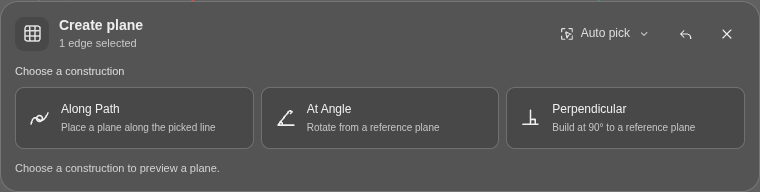
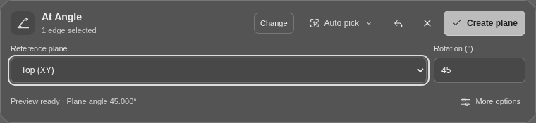

<p align="center">
  
</p>

<h1 align="center">MeshToZero</h1>

<p align="center">
  A browser-based workspace for centering, orienting, and precisely aligning 3D meshes and point clouds.
</p>

<p align="center">
  <a href="https://espmaniac.github.io/MeshToZero/"><strong>Open MeshToZero</strong></a>
</p>

## Overview

MeshToZero provides non-destructive tools for preparing PLY, OBJ, and STL models directly in the browser. Import a model, create geometric reference planes, align it to world axes or the XY bed, and export the transformed geometry in its original format.

The application is built with HTML, CSS, JavaScript, and Three.js. It has no framework dependency, build step, account requirement, or server-side component.

## Workflow

1. Import or drag and drop a PLY, OBJ, or STL file.
2. Inspect the model as a mesh, edge view, vertex view, or point cloud.
3. Move, rotate, and scale with numeric fields or the transform gizmo.
4. Create automatic or manual construction planes from the model geometry.
5. Compare a fitted model surface with a chosen X, Y, Z, or construction plane.
6. Auto-orient the model from one of several detected planes or axes, align it manually, lay a selected surface flat, or drop it onto the XY bed.
7. Review or restore any operation from Transform History.
8. Export the transformed model in the same format as the imported file.

## Features

### Transform and placement

- Center-pivot Move and Rotate gizmos
- World and Local coordinate spaces
- Position-to-grid and rotation-to-angle snapping
- CAD object snaps for vertices, edge midpoints, nearest edge points, faces, centers, and plane intersections
- Snap-to-snap translation from a model reference to Grid, a world-plane intersection, or World Origin
- Linked or independent scale controls
- Auto Orient variants from planar or dominant mesh-surface directions, point-cloud plane fits, cylindrical or elongated symmetry axes, and oriented bounds
- Explicit X / Right, Y / Front, and Z / Top targets for every automatic variant
- Central preview plane saved as reusable construction geometry when Auto Orient is applied
- Sequential plane-to-world alignment
- Normal flipping and 90-degree turns around a target normal
- Lay Flat placement from a selected mesh or point-cloud surface
- Exact Drop to Bed placement without changing model rotation
- Non-destructive alignment previews

### Construction geometry

- Automatic Top, Front, and Right model planes
- Model-oriented and source-axis boundary-box planes
- Separate boundary-face and center-plane sets
- Planes through points, edges, paths, and triangles
- Local planar-surface detection for meshes and point clouds
- Best-fit, tangent, offset, angle, midplane, and perpendicular planes
- Model-space planes that follow model transformations
- Fixed Top, Front, and Right world-origin grids

### Plane inspector

- Local planar-surface fitting on meshes and point clouds
- Explicit X / Right, Y / Front, and Z / Top reference-plane controls
- Comparison with any user-created construction plane
- Reference-plane selection from the inspector or by clicking a visible plane in the viewport
- Angular deviation, alignment state, and normal-match percentage for the chosen plane
- Surface and reference normals, sample count, and RMS fit quality

### Editing and navigation

- Model-centered orbit, unrestricted camera rotation, pan, zoom, and fit
- Mesh, edge, vertex, and point-cloud display modes
- Fixed neutral-gray interface palette
- Responsive desktop and mobile layout
- 100-step undo and redo
- Clickable Photoshop-style Transform History
- Full-workspace file drag and drop

## Supported formats

| Format | Import | Export | Notes |
| --- | --- | --- | --- |
| OBJ | Yes | Yes | Geometry only; external MTL files and textures are not loaded |
| PLY | Yes | Yes | Meshes and point clouds; ASCII or binary representation is preserved |
| STL | Yes | Yes | ASCII or binary representation is preserved |

Current model transformations are baked into exported vertex coordinates.

## Controls

| Input | Action |
| --- | --- |
| Left click | Select model geometry or interact with tools |
| Middle-mouse drag | Orbit around the current model center |
| Right-mouse drag | Pan |
| Mouse wheel | Zoom |
| ViewCube face | Switch to the corresponding orthogonal view |
| ViewCube corner | Switch to the corresponding isometric view |
| ViewCube Home button | Restore the home view and fit the model |
| `Ctrl+Z` | Undo |
| `Ctrl+Y` or `Ctrl+Shift+Z` | Redo |

## Technical notes

- Requires a modern browser with WebGL 2 support
- Uses pinned Three.js ES modules from jsDelivr
- Runs entirely in the browser
- Published as a static GitHub Pages application

## Workspace controls

- The top command strip groups model transforms, alignment, and construction tools. Scroll the strip horizontally on narrow screens.
- Scene objects, reference planes, and edit history stay in the left panel. Use the Scene button to open this panel on smaller screens.
- Construction methods, axis targets, coordinate spaces, and geometry snaps pair icons with text labels.
- Workspace settings contains coordinate space, grid and angle increments, and geometry snapping. The status bar shows whether snapping is active. Settings apply immediately for the current session.
- The top reference grid is shown initially; enable Front and Right in the Scene panel as needed.
- The viewport fills the window behind the interface. ViewCube is centered above the coordinate readout at the bottom right.

### Manual construction preview

Manual shows a temporary plane as soon as the selected method has enough valid references. Offset and Midplane update immediately from their reference plane choices. Distance, angle, and path-position edits update the same geometry that Create Plane saves. Invalid geometry or nonfinite parameters remove the preview and explain what needs changing.

Before the last required pick, pause the pointer over a model reference to preview the result. Planar Surface and Tangent can preview the first surface by hover; point-based methods preview the next point once it can define a plane. Hover never adds a reference or an edit-history entry: click to confirm it. Leaving the canvas restores the preview of the confirmed selection. Touch users see the preview after tapping references.

Create Plane removes the temporary visual after saving. Change a parameter/reference or reopen the tool to preview another construction. Clearing picks, changing methods/modes, closing the tool, Escape, and model replacement clear or rebuild the preview from the current inputs; a pending hover cannot recreate an old plane after cancellation.

### Interactive plane picking

Create Plane opens in **Pick from model** mode. Hover to inspect a reference, then click surfaces, real feature edges, or points. The bottom viewport toolbar replaces its history and navigation buttons with the active tool's controls. Closing the tool or switching modes restores the standard buttons.

Construction methods appear progressively from the picked geometry. No methods or parameter fields are shown before the first pick. A surface reveals surface-based constructions; an edge or two points reveals Along Path, At Angle, and Perpendicular. Three points reveal 3 Points and Best Fit; two edges reveal 2 Edges and Best Fit. A surface or plane also offers Midplane, so its second reference can be chosen directly in the toolbar. Matching methods appear as labeled cards with a short explanation; there is no duplicate method dropdown.

Choosing a card replaces the choices with the selected method and only its relevant parameter fields. **Change** reopens the cards; **Back** or Escape returns to the current method without changing its values. The active method and edited parameters stay selected through additional picks and partial Undo, even while geometry is incomplete. Clear or Undo to an empty selection hides the methods and fields until geometry is picked again. A unique exact construction is previewed automatically; ambiguous choices require selecting a method. Invalid geometry disables Create with an explanation, and exact construction never silently falls back to Best Fit. All ten Manual constructions remain supported through the appropriate selections; the Manual tab retains its complete method chooser.





| Method | Geometry and toolbar fields |
| --- | --- |
| Planar Surface | One flat mesh area or point-cloud area |
| 3 Points | Three noncollinear points |
| Best Fit | Three or more points / edge endpoints |
| Tangent | One mesh surface location with a normal |
| 2 Edges | Two coplanar feature edges, one edge and two endpoints, or four ordered endpoints |
| Along Path | One edge or two ordered points; position from 0% to 100%, Reverse path |
| Offset | Reference plane or picked flat surface; signed distance |
| At Angle | One edge or two points; reference plane and axis rotation |
| Midplane | Two parallel picked surfaces or reference planes; Reference and Second plane selectors |
| Perpendicular | One edge or two points; reference plane |

**At Angle example:** pick an edge, choose At Angle, choose the reference plane and enter the angle in the bottom toolbar. No plane pick or switch to Manual is required. A suggested origin plane is chosen to avoid an axis normal to it; a picked flat surface takes priority. Reference selectors include origin planes, saved construction planes, and currently picked flat surfaces. Offset starts from a picked surface or reference plane; the reference selector can then change its source. Midplane accepts picked faces, selected planes, or a combination.

Auto picking follows an explicitly selected method: surface methods select surfaces, point methods select points, and axis methods accept edges or points. Before a method is chosen, Auto continues selecting surfaces after the first surface so opposite faces can directly produce a Midplane. Auto can also select visible construction/origin planes where the pointer misses the model. Open **Auto pick** (or the current picking filter) and choose **Planes** to select planes through the model, or choose an origin or saved plane and press **Add plane**. The Points, Edges, and Surfaces filters override automatic picking. Point clouds support points, flat-area fitting, and local best fit; they do not supply tangent normals. **Model center**, enabled object snaps, and grid snapping in Points mode remain available. Up to 32 references are supported.

Additional inferred constructions include Edge + Point, Parallel through Point, and Local Best Fit. The primary fields belong to the selected construction: reference planes, angle, path position/direction, or Offset distance. **More options** contains the optional name, Flip normal, and an additional signed offset in the indicated world/model space. Picking filters and Model center are grouped under the picking-options button. Controls wrap within the toolbar on narrow screens; the header stays visible when an expanded panel needs to scroll on a short screen.

Offset, At Angle, Perpendicular, and Parallel through Point retain the reference plane's coordinate space. Midplane uses the shared reference space, or world space for mixed references. World constructions stay fixed when the model moves, and offsets from world references remain exact world distances after nonuniform scaling. Other constructions follow the model.

At Angle rotates the reference orientation around any nonzero picked axis, as Manual does. The toolbar reports axis rotation and actual plane inclination separately; they can differ for an oblique axis. Perpendicular requires a line that is not normal to its reference plane. Midplane requires parallel planes, handles opposite-facing normals, and accepts distinct coincident references.

A valid construction shows a temporary preview. **Create Plane** saves it and adds an undoable history entry. Closing the tool or changing modes removes the preview. Undo pick removes the last reference without saving; an active method remains visible while references remain. Clear, Undo to zero picks, and saving hide the contextual methods and clear the preview until geometry is picked again. Automatic whole-model analysis and the existing Manual workflow remain available.

Geometry regression checks can be run from the browser console while the app is open:

```js
(await import("./tests/smart-plane.browser.js")).runSmartPlaneTests();
```

The toolbar interaction regression test uses Playwright for Python and a local static server:

```sh
python -m http.server 8000
# In another terminal, after installing playwright:
python tests/plane-toolbar.playwright.py --base-url http://127.0.0.1:8000
```

Set `CHROMIUM_EXECUTABLE` if Chromium is installed outside `/usr/bin/chromium`.
